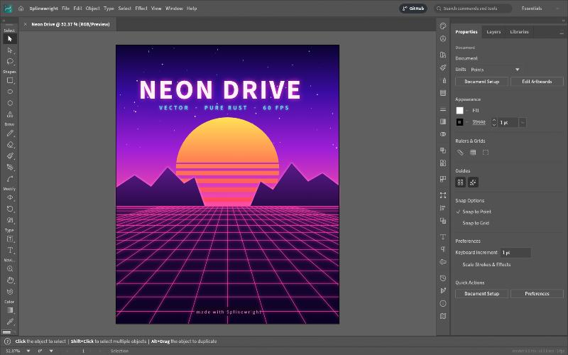
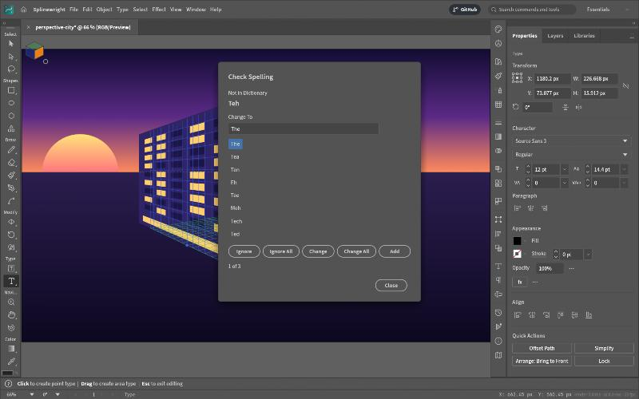
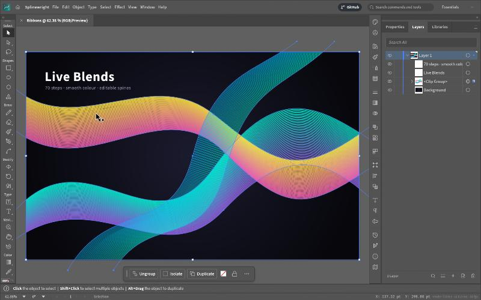
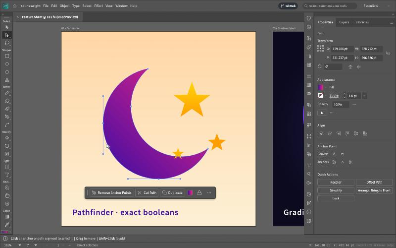
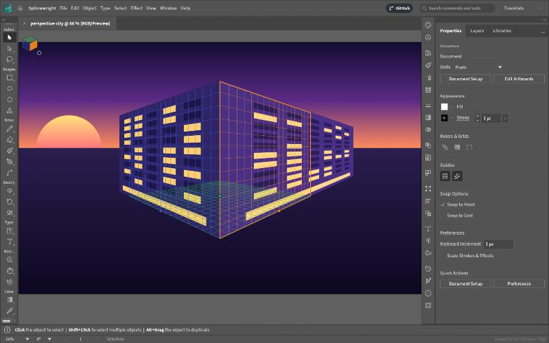
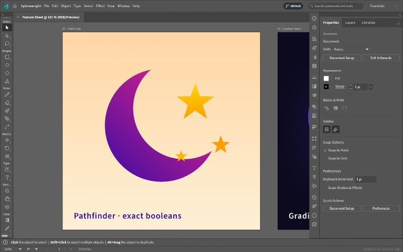

<h1 align="center">Splinewright</h1>

<p align="center">
  <b>A fast, open-source vector illustration app written entirely in Rust.</b><br>
  Pen and Pathfinder, live effects, gradient meshes, perspective grids, type, real SVG and PDF,<br>
  with a scriptable command line, an MCP server for AI agents, and the very same editor running in your browser.
</p>

<p align="center">
  
  
  
  
</p>

<p align="center">
  <a href="https://www.jonmcgee.online/apps/splinewright/"><b>Try it in your browser</b></a> ·
  <a href="#quick-start">Build it</a> ·
  <a href="#whats-new-in-this-fork">What's new</a> ·
  <a href="#status">Status</a> ·
  <a href="#the-family">The family</a> ·
  <a href="#credits-and-license">Credits</a>
</p>

<p align="center">
  
  <br><sub>The real app. <b>Neon Drive</b>: a Pathfinder-cut sun, live Outer Glow on the type and grid, and clipping masks · <code>examples/neon-drive.splinewright</code></sub>
</p>

Splinewright is a fork of [VectorCraft](https://github.com/storytold/vectorcraft), a clean-room, Rust-only vector illustration app by the ArtCraft Team and contributors. It keeps their engine (a pure-data document, one registry of commands that the menus, the command line, a JSON control channel and an MCP server all share) and builds on it, with the original authors credited [below](#credits-and-license). **Try it now: <https://www.jonmcgee.online/apps/splinewright/>**, the real program compiled to WebAssembly, running entirely in your browser tab.

## What's new in this fork

First finished features from the roadmap's gap list, then additions of my own. Everything is a registered command, so it is in the menus, the command search, the control channel and MCP, and has tests and translations.

<p align="center">
  
  <br><sub>Edit › Spelling › Check Spelling…, running in the browser build</sub>
</p>

| Feature | Where | What it does |
|---|---|---|
| **Check Spelling** | Edit › Spelling › Check Spelling… (Cmd/Ctrl+I) · `type.checkSpelling` | The roadmap listed spelling as missing. A bundled English dictionary (SCOWL, 72,000 words) checks the selected type, or all of it, in a dialog that steps through misspellings with suggestions: Change, Change All, Ignore, Ignore All, Add to dictionary. Changes are one undo step. |
| **Custom dictionary** | Edit › Spelling › Edit Custom Dictionary… · `type.spell.addWord` | Words you add are kept in Preferences › Type and accepted in any case. |
| **Check Contrast** | Object › Check Contrast · `object.checkContrast` | The WCAG 2 contrast ratio between two objects (type uses its first character's fill), or one object and a background colour, and whether it passes AA, AAA and the large-text and graphics levels. |
| **Help (F1)** | Help › Splinewright Help… · `help.docs` | Finishes a stubbed menu item: opens the documentation. |
| **`splinewright-cli palette`** | CLI | The colours a document is drawn with, most used first, as text, hex or JSON. |
| **`splinewright-cli contrast`** | CLI | `splinewright-cli contrast "#767676" "#ffffff"` prints the ratio and which levels pass; exits 1 below AA. |

The speller is the PhotoCraft/Pixelwright one, ported. See [`docs/fork-changes.md`](docs/fork-changes.md) for the complete list, including the rebrand.

<p align="center">
  <a href="#a-look-around">A look around</a> ·
  <a href="#made-in-splinewright">Made in Splinewright</a> ·
  <a href="#why-splinewright">Why Splinewright</a> ·
  <a href="#quick-start">Quick start</a> ·
  <a href="#status">Status</a> ·
  <a href="#downloads">Downloads</a> ·
  <a href="#the-family">The family</a> ·
  <a href="#license-and-credits">License</a>
</p>

## A look around

<table>
<tr>
<td width="50%" valign="top">
  
  <p align="center"><sub><b>Live Blends and Layers</b>: editable key paths, smooth colour, every object a row</sub></p>
</td>
<td width="50%" valign="top">
  
  <p align="center"><sub><b>Pen and Direct Selection</b>: real Bézier anchors and handles, plus a contextual task bar</sub></p>
</td>
</tr>
<tr>
<td width="50%" valign="top">
  
  <p align="center"><sub><b>Perspective Grid</b>: art attached to its planes stays editable in perspective · <code>examples/perspective-city.splinewright</code></sub></p>
</td>
<td width="50%" valign="top">
  
  <p align="center"><sub><b>Multiple artboards</b>: Pathfinder · Gradient Mesh · live radial Repeat · Envelope Distort · <code>examples/feature-sheet.splinewright</code></sub></p>
</td>
</tr>
</table>

## Made in Splinewright

Every piece below was built entirely through Splinewright's command API, the same one the MCP server
exposes to agents, and exported by Splinewright's own renderer. The source files are in
[`examples/`](examples).

<table>
<tr>
<td width="50%" valign="top">
  
  <p align="center"><sub><b>Neon Drive</b>: synthwave poster with glowing type and grid</sub></p>
</td>
<td width="50%" valign="top">
  
  <p align="center"><sub><b>Dusk</b>: gradient sky, glowing sun, layered mountains</sub></p>
</td>
</tr>
<tr>
<td colspan="2" valign="top">
  
  <p align="center"><sub><b>Live Blends</b>: 70 steps, smooth colour, editable spines</sub></p>
</td>
</tr>
<tr>
<td width="50%" valign="top">
  
  <p align="center"><sub><b>Radial Repeat</b>: a live mandala</sub></p>
</td>
<td width="50%" valign="top">
  
  <p align="center"><sub><b>Envelope Distort</b>: striped type warped into a flag</sub></p>
</td>
</tr>
<tr>
<td width="50%" valign="top">
  
  <p align="center"><sub><b>Gradient Mesh</b>: shaded spheres</sub></p>
</td>
<td width="50%" valign="top">
  
  <p align="center"><sub><b>Pathfinder</b>: a crescent and stars from exact booleans</sub></p>
</td>
</tr>
</table>

## Why Splinewright

- **Familiar.** Illustrator's layout, tools, menus, panels and shortcuts: the Pen, Direct Selection,
  Pathfinder, Smart Guides, Appearance, Swatches, Layers and more. You already know how to use it.
- **Fast.** Multithreaded SIMD rendering off the UI thread. 20,000 shapes render in about 27 ms at
  full retina resolution while the interface stays at 120 fps.
- **Robust.** Exact curve booleans (no "cannot perform operation"), unlimited undo via structural
  sharing, and property-tested file round trips.
- **Open.** A documented native format (`.splinewright`, JSON), first-class SVG, PDF (and
  PDF-compatible `.ai`) import and export, PNG/JPEG/WebP export, Export for Screens, and SVGZ,
  templates, GIF, TIFF and BMP on open.
- **Agent-native.** Every menu item, tool gesture, panel and dialog can be driven over a JSON
  control channel and an **MCP server**, so Claude and other agents can draw, edit and export the
  way a person does.
- **Everywhere.** One codebase for the desktop apps and the same UI in the browser.

## Quick start

```sh
cargo run --release -p splinewright                          # desktop app
cargo run --release -p splinewright -- examples/dusk-poster.splinewright
cargo run --release -p splinewright -- --control 7979        # + JSON control channel
cargo run --release -p splinewright-cli -- mcp               # MCP server (stdio)
cargo run --release -p splinewright-cli -- run --in examples/ribbons.splinewright --export out.pdf   # headless batch
cargo run --release -p splinewright-cli -- bench examples/neon-drive.splinewright                   # render timing
cargo xtask bundle                                        # dist/Splinewright.app (macOS)
cd apps/splinewright-web && trunk build --release            # web build → dist/web
cargo xtask ci                                            # fmt, clippy, tests, layering, wasm, vendor names
```

Japanese fonts come from [storytold/craft-fonts](https://github.com/storytold/craft-fonts), an optional
build input (releases always use it): `CRAFT_FONTS_DIR="$PWD/../craft-fonts" cargo run --release -p splinewright` (an absolute path).
Without it, Japanese text uses the installed system fonts. See [`docs/development.md`](docs/development.md#fonts-craft-fonts-optional-build-input).

On machines with two graphics processors, Splinewright renders on the power-saving (integrated) one by default on
Windows and macOS, and on the one the desktop runs on under Linux. To choose, use **Preferences › Performance ›
Graphics Processor** and restart. If a graphics processor can't show the window, Splinewright starts again on the
next one. To pick one when starting the app, set `WGPU_POWER_PREF=high` (or `low`), or `WGPU_ADAPTER_NAME` to part of
its name, such as `WGPU_ADAPTER_NAME=nvidia` (see [`docs/development.md`](docs/development.md#desktop-graphics-processor)).

On Linux under KDE Plasma 6.3 or later with Wayland, a drawing tablet's pen moves the cursor but Splinewright doesn't
respond to it yet (#491). Start the app under XWayland instead: `WAYLAND_DISPLAY= splinewright` (see
[`docs/development.md`](docs/development.md#linux-wayland-and-x11)).

### Use it from Claude Code and other agents

Register the MCP server with Claude Code:

```sh
claude mcp add splinewright -- /path/to/splinewright-cli mcp
```

The details are in [`docs/mcp.md`](docs/mcp.md) and [`docs/control-protocol.md`](docs/control-protocol.md).

For the experimental, unsupported 64-bit Windows 7 build, see [Windows 7 instructions](docs/windows7.md).

## Status

Splinewright is under active development. [**ROADMAP.md**](ROADMAP.md) covers what ships today, the
milestones, and honest time-to-parity estimates.

**Where we are (2026-10-07):** roughly 69–75% of Illustrator's features exist and work, and about 40–55% of
"a power user can't tell the difference". Everyday vector illustration is close to usable: drawing and path tools,
Pathfinder and Shape Builder, paint, gradients, appearance and transparency, type with styles, threading and Hebrew/Arabic bidirectional layout, and
files (SVG, PDF and PDF-compatible `.ai` with PDF/X, EPS, DXF, EMF/WMF, raster formats and PSD, Print, Package). The interface
speaks English, Japanese, Traditional and Simplified Chinese, Spanish and Italian (and Czech and Brazilian Portuguese in the menus).
The scores are
self-assessed, so the [honest assessment](ROADMAP.md#honest-assessment-2026-10-05) explains how far to trust them.

**What's missing:**
- 3D and Materials;
- the Photoshop-style raster effects (Effect Gallery);
- CJK composition for vertical type (vertical type itself has initial support, with a Japanese interface);
- Variables and scripting;
- an interaction-fidelity pass covering every tool's modifiers and small behaviours;
- packaging for Windows and Linux.

**Where we're going:** next is the interaction-fidelity pass alongside the raster-effects package, then 3D and
advanced type, then hardening and packaging for 1.0. The prioritized list is in
[Where we're lacking](ROADMAP.md#where-were-lacking-in-priority-order).

**Workspace:** `crates/{geom, color, doc, pathops, text, effects, trace, brush, render, svg, pdf, eps, cad, metafile, format, tools, engine, ui-egui, mcp, testkit}`
and `apps/{splinewright, splinewright-cli, splinewright-web}`. The egui frontend is its own crate, so
the UI can be swapped without touching the engine.

Agent and contributor rules (clean-room, the asset policy, no panics in shipped code, quality gates) are in
[`AGENTS.md`](AGENTS.md); [`docs/development.md`](docs/development.md#robustness-splinewright-never-crashes)
explains how Splinewright avoids crashing, and [`docs/releasing.md`](docs/releasing.md) how releases are built,
signed and published. Every bundled asset is listed with its licence in [`ASSETS.md`](ASSETS.md).

## Downloads

No release has been published yet. Until the first one, build from source (see [Quick start](#quick-start)) or use the browser build at <https://www.jonmcgee.online/apps/splinewright/>.

Release builds are made by [`.github/workflows/release.yml`](.github/workflows/release.yml) when the `release` branch is pushed (or the workflow is run by hand): Windows (x64, arm64, x86) MSI installers and portable zips, a universal macOS DMG, Linux AppImage, Flatpak, `.deb`, `.rpm` and tarballs, FreeBSD tarballs and the web build, each with a `SHA256SUMS.txt`. This fork has no signing certificates, so those builds are **unsigned**: Windows SmartScreen and macOS Gatekeeper will warn before the first run.
## The family

Splinewright is one of a growing family of forks of the ArtCraft Team's creative apps. Each has its own repository and a live preview in the browser:

| | App | What it is for | Forked from | Code | Live preview |
|:-:|---|---|---|---|---|
|  | **Pixelwright** | Image editing: layers, masks, type and real PSD files | [PhotoCraft](https://github.com/storytold/photocraft) | [GitHub](https://github.com/game7ballJT/pixelwright) | [Try it](https://www.jonmcgee.online/apps/pixelwright/) |
|  | **Splinewright** (you are here) | Vector illustration: paths, Pathfinder, live effects, SVG and PDF | [VectorCraft](https://github.com/storytold/vectorcraft) | [GitHub](https://github.com/game7ballJT/splinewright) | [Try it](https://www.jonmcgee.online/apps/splinewright/) |
|  | **Reelwright** | Video editing, color and sound | [FilmCraft](https://github.com/storytold/filmcraft) | [GitHub](https://github.com/game7ballJT/reelwright) | [Try it](https://www.jonmcgee.online/apps/reelwright/) |

## Credits and license

Splinewright is a modified fork of **[VectorCraft](https://github.com/storytold/vectorcraft)**, copyright (c) 2026 the ArtCraft Team and the VectorCraft contributors, whose work this repository builds on and whose history it preserves. All of it, and the changes made here, are available under the same terms: [MIT](LICENSE-MIT) or [Apache-2.0](LICENSE-APACHE), at your option. This fork is independent and is not affiliated with or endorsed by the upstream authors; it carries none of their branding, as their brand license requires of forks. Required notices are in [NOTICE](NOTICE).

Bundled fonts, icons and other assets keep their own open licenses; each one is listed with its author, source and license in [ASSETS.md](ASSETS.md). The app icon is original work made for this project. The artwork under `docs/images/` and `examples/` was made with Splinewright itself.

<sub>Adobe, Illustrator and other product names are trademarks or registered trademarks of Adobe Inc. in the United States and/or other countries. Splinewright is an independent open-source project, is not affiliated with, sponsored by or endorsed by Adobe Inc., and uses these names only to describe the file formats and workflows it is compatible with.</sub>
